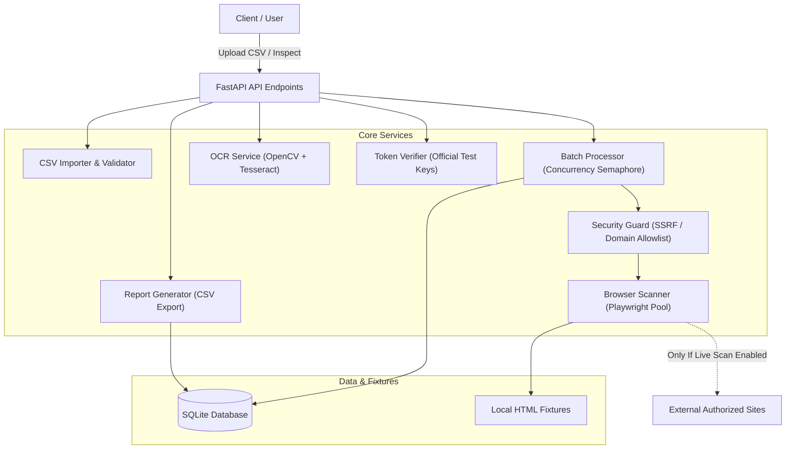
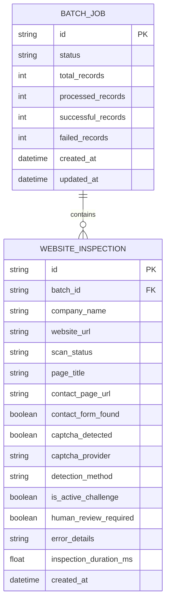

# System Architecture & Technical Design

## 1. System Overview

The **CAPTCHA Automation Tool** is a modular backend system designed for bulk website inspection, automated detection and classification of CAPTCHA challenges, SSRF-safe scanning, synthetic OCR demonstration, and CSV compliance reporting.

The application follows an asynchronous, layered architecture:
- **Presentation & API Layer**: FastAPI REST endpoints with OpenAPI / Swagger documentation and Pydantic validation schemas.
- **Service Orchestration Layer**: Batch processing pipeline with bounded concurrency (`asyncio.Semaphore`), CSV parsing engine, and security policy enforcement.
- **Detection & Inspection Engine**: Playwright-based headless browser automation distinguishing active CAPTCHA widgets from passive script markers and anti-bot interstitials.
- **Verification & OCR Subsystems**:
  - Tesseract OCR + OpenCV preprocessing pipeline for synthetic CAPTCHA benchmark analysis.
  - Official Google reCAPTCHA server-side test token verification client.
- **Persistence Layer**: SQLAlchemy 2.0 ORM with SQLite storage, structured tracking of batch jobs, and granular inspection results.

---

## 2. Component Design

### 2.1 API Layer (`app/routes/`)
- `websites.py`:
  - `POST /api/websites/import`: Validates company name and website URL headers and syntax.
  - `POST /api/websites/inspect-demo`: Ingests and inspects single HTML content locally.
  - `POST /api/websites/inspect-demo-batch`: Ingests multiple HTML pages, continuing despite individual page failures.
  - `POST /api/websites/scan-batch`: Creates batch job, validates authorization, and triggers asynchronous scanning.
  - `GET /api/websites/batches/{batch_id}`: Retrieves real-time batch execution status and progress summary.
  - `GET /api/websites/batches/{batch_id}/results`: Retrieves itemized inspection results.
  - `GET /api/websites/batches/{batch_id}/report`: Exports full inspection audit log to downloadable CSV.
- `captcha.py`:
  - `POST /api/captcha/ocr-demo`: Generates synthetic CAPTCHAs, applies OpenCV filters, extracts text via Tesseract, and computes execution time.
  - `POST /api/captcha/verify-token`: Verifies test responses against Google reCAPTCHA API with test secret keys.

### 2.2 Security Guard (`app/services/security_guard.py`)
Enforces strict security isolation:
1. `ENABLE_LIVE_SCAN` flag must be set to `true` to allow outbound HTTP/HTTPS requests.
2. Scheme enforcement: Only `http://` and `https://` protocols permitted.
3. Private & Loopback IP rejection: Blocks RFC 1918 subnets (`10.0.0.0/8`, `172.16.0.0/12`, `192.168.0.0/16`), loopback (`127.0.0.0/8`, `::1`), link-local (`169.254.0.0/16`), and metadata addresses (`169.254.169.254`).
4. DNS Resolution & Rebinding Protection: Resolves hostnames prior to browser navigation to confirm target IP is public.
5. Domain Allowlisting: Allows scans only against domains explicitly defined in `ALLOWED_DOMAINS`.

### 2.3 Browser Scanner & Detection Engine (`app/services/browser_scanner.py`)
- Reuses browser contexts to avoid launching whole browser processes per inspection.
- Distinguishes:
  - **Active CAPTCHA Widgets**: Interactive elements presenting a challenge (`.g-recaptcha`, `iframe[src*="recaptcha"]`, `.h-captcha`, `.cf-turnstile`).
  - **Passive Script Tags**: Script tags loading vendor SDKs without active widget rendering.
  - **Anti-Bot Interstitials / Unknown Challenges**: Interstitial blocking pages (Cloudflare Just a Moment, Datadome, PerimeterX/HUMAN) classified as `unsupported_challenge` with `human_review_required=true`.
  - **Clean Contact Forms**: Identifies contact forms with inputs/textareas and verifies absence of CAPTCHA challenges.

### 2.4 Persistence Model (`app/models.py`)

---

## 3. Concurrency & Resource Management
- **Controlled Concurrency**: Bounded with `asyncio.Semaphore(MAX_CONCURRENT_PAGES)` (default: 3).
- **Navigation Timeouts**: Hard timeout per site navigation (`REQUEST_TIMEOUT_MS=15000`) prevents hanging connections.
- **Resource Discarding**: Browser pages and contexts are explicitly closed in `finally` blocks to prevent memory leaks during large batch runs (~200 records).
- **Zero Form Submission**: Browsing is strictly read-only; no buttons are clicked, forms submitted, or challenge bypasses attempted.
