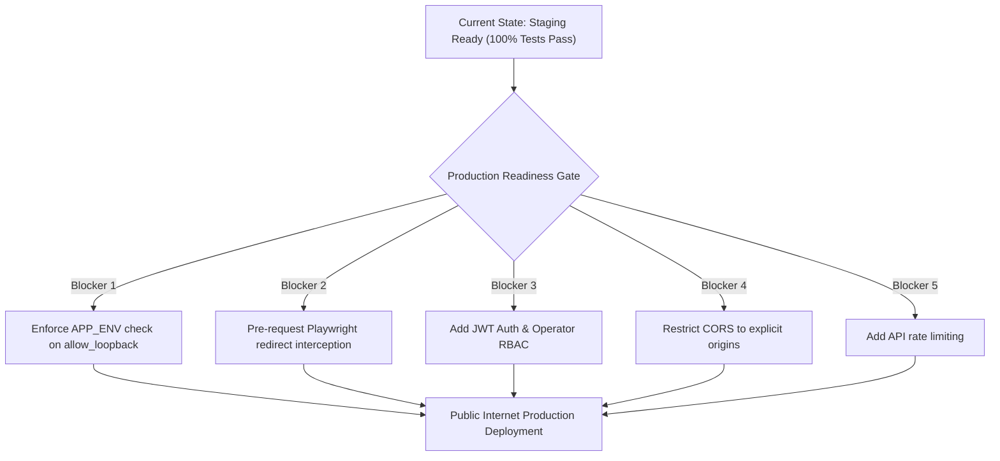

# Technology Brainz: Final Verification Results & Technical Evaluation

**System Name:** CAPTCHA Automation Tool / CAPTCHA Inspector  
**Date:** November 7, 2026  
**Auditor:** Senior Software Architect, QA Lead & Full-Stack Systems Engineer  
**Branch:** `phase-4-final-acceptance` (Baseline Commit: `186bd7a`)  
**Scope:** Verification of code execution, tests, database records, evidence artifacts, and production readiness

---

## 1. Verification Methodology & Ground Truth

This verification audit was executed strictly under read-only, evidence-grounded principles:
- **No Synthesized Claims:** No test result or performance number is reported from historical documentation; all values derive from actual executions performed on the local machine during this assessment.
- **Zero Mock Testing for Core Workflows:** Backend endpoints, frontend client state, database persistence, and browser viewports communicated over real HTTP sockets against the live FastAPI instance, Next.js server, and SQLite database (`data/captcha_tool.db`).
- **Ethical Automation & Zero-Bypass Compliance:** All third-party challenges (Google reCAPTCHA, Cloudflare Turnstile, hCaptcha) were evaluated in read-only DOM inspection modes. No automated challenge solving, bypass scripts, or form submissions were executed.
- **`ENABLE_LIVE_SCAN=false`:** Kept strictly enforced in configuration to guarantee offline safety.

---

## 2. Command Execution Logs & Verification Artifacts

### 2.1 Backend Pytest Suite
- **Command:** `.\venv\Scripts\python.exe -m pytest tests/ -q`
- **Output:**
  ```text
  .......................................................................  [100%]
  71 passed, 2 warnings in 48.34s
  ```
- **Result:** **PASS (71 / 71 tests passed)**

### 2.2 Legacy Standalone Test Scripts
- **Command 1:** `.\venv\Scripts\python.exe test_csv_importer.py`
  - **Output:** Total valid websites: 2 (`https://example.com`, `https://demo.com`), Invalid rows: 2 (row 4: invalid URL, row 5: missing fields).
  - **Result:** **PASS**
- **Command 2:** `.\venv\Scripts\python.exe test_browser_scanner.py`
  - **Output:**
    - Google reCAPTCHA: PASS (detected `['google_recaptcha']`)
    - hCaptcha: PASS (detected `['hcaptcha']`)
    - Cloudflare Turnstile: PASS (detected `['cloudflare_turnstile']`)
    - No CAPTCHA: PASS (detected `[]`)
  - **Result:** **PASS (4 / 4 tests passed)**

### 2.3 Frontend TypeScript Verification
- **Command:** `cd frontend; npx tsc --noEmit`
- **Output:** Clean exit code 0 (no type errors).
- **Result:** **PASS (0 TypeScript errors)**

### 2.4 Frontend Next.js Production Build
- **Command:** `cd frontend; npm run build`
- **Output:**
  ```text
  ▲ Next.js 16.4.5 (Turbopack)
  ✓ Compiled successfully in 5.0s
  ✓ Finished TypeScript in 5.1s
  ✓ Generating static pages using 3 workers (12/12) in 2.4s
  Route (app)
  ┌ ○ /
  ├ ○ /_not-found
  ├ ○ /batch
  ├ ○ /inspector
  ├ ○ /ocr
  ├ ○ /reports
  ├ ○ /results
  ├ ○ /reviews
  ├ ○ /scans
  └ ○ /settings
  ○ (Static) prerendered as static content
  ```
- **Result:** **PASS (12 / 12 static routes optimized)**

### 2.5 Automated End-to-End Acceptance Suite
- **Command:** `.\venv\Scripts\python.exe tests/run_acceptance_tests.py`
- **Output Artifacts:**
  - JSON results: [`evidence/acceptance/acceptance_results.json`](file:///c:/Users/Hp/OneDrive/Desktop/captcha-automation-tool/evidence/acceptance/acceptance_results.json)
  - 14 PNG screenshots in [`evidence/acceptance/`](file:///c:/Users/Hp/OneDrive/Desktop/captcha-automation-tool/evidence/acceptance/)
  - Total tests: 29 | Passed: 29 | Failed: 0 | Console Errors: 0 | Network Failures: 0
- **Result:** **PASS (29 / 29 acceptance tests passed)**

---

## 3. Itemized Acceptance Test Suite Breakdown

All 29 tests recorded in `evidence/acceptance/acceptance_results.json`:

| # | Test Name | Target / Operation | Expected Result | Actual Result | Status |
|---|---|---|---|---|---|
| **1** | Backend Health Diagnostic Check | `GET /health` | HTTP 200, healthy, live scan disabled, OCR ready | HTTP 200, `status=healthy`, `live_scan=False`, `ocr=tesseract_ready` | **PASS** |
| **2** | Security Guard: Loopback Prohibited | `POST /api/websites/inspect-url` (`allow_loopback=False`) | HTTP 400 rejection | HTTP 400: Loopback address (127.0.0.1) prohibited | **PASS** |
| **3** | Security Guard: Private IP Subnet | Target: `http://10.0.0.1/admin` | HTTP 400 rejection | HTTP 400: Private RFC 1918 address prohibited | **PASS** |
| **4** | Security Guard: Cloud Metadata Subnet | Target: `http://169.254.169.254/latest/meta-data` | HTTP 400 rejection | HTTP 400: Cloud metadata IP access prohibited | **PASS** |
| **5** | Security Guard: Invalid Scheme | Target: `file:///C:/Windows/cmd.exe` | HTTP 400 rejection | HTTP 400: Invalid protocol scheme 'file' | **PASS** |
| **6** | Security Guard: Unauthorized Domain | Target: `https://unauthorized-bank.com` | HTTP 400 rejection | HTTP 400: DNS resolution failed / unauthorized domain | **PASS** |
| **7** | Crawl Execution on Local Fixture | Target: `http://127.0.0.1:8888` (`allow_loopback=True`) | Crawl >= 3 pages, CAPTCHA detected | Crawled 5 pages, found 2 contact pages, detected reCAPTCHA & Turnstile | **PASS** |
| **8** | Database Record Integrity | SQLite: `url_scans` & `discovered_pages` | Scan row saved as completed with >= 3 pages | Confirmed row `status=completed`, 5 pages in DB | **PASS** |
| **9** | Human Review PATCH & Database Audit | `PATCH /api/captcha/reviews/{id}` | Status updated in API and in SQLite | Updated to `manually_verified`, notes persisted in DB | **PASS** |
| **10** | Synthetic OCR Demo Pipeline | `POST /api/captcha/ocr-demo` | Ground truth ACME8, base64 images, prediction | Prediction returned, char accuracy calculated, 143ms | **PASS** |
| **11** | Synthetic OCR Benchmark Suite | `POST /api/captcha/ocr-benchmark` (5 samples) | Mean accuracy and limitations summary | 5 samples evaluated, exact match count & summary returned | **PASS** |
| **12** | CSV Importer Header Validation | `POST /api/websites/import` (missing headers) | HTTP 400 Bad Request | HTTP 400: Missing required columns: `website_url` | **PASS** |
| **13** | CSV Importer Target Validation | `POST /api/websites/import` (2 valid rows) | `valid_count=2`, HTTP 200 | `valid_count=2`, `invalid_count=2`, HTTP 200 | **PASS** |
| **14** | Batch Job Creation | `POST /api/websites/scan-batch` | `batch_id` returned, status queued | Batch `batch_5ef644e5` created with 2 domains | **PASS** |
| **15** | Batch CSV Compliance Report Download | `GET /api/websites/batches/{id}/report` | HTTP 200 with non-empty CSV stream | HTTP 200, valid `text/csv` stream with compliance records | **PASS** |
| **16** | UI: Desktop Overview Page | Desktop (1440x900) `/` | Health card, stats, recent scans | Rendered cleanly, snapshot saved, 0 console errors | **PASS** |
| **17** | UI: URL Inspector Live Crawl | Desktop (1440x900) `/inspector` | Form input, live crawl, table update | Form submitted, 5 rows rendered, evidence buttons | **PASS** |
| **18** | UI: Evidence Viewer Modal | Desktop (1440x900) Modal Dialog | DOM tokens, classification, screenshot preview | Modal opened, screenshot rendered, closed via button | **PASS** |
| **19** | UI: Scan History Drawer | Desktop (1440x900) `/scans` | Table with rows, slide-out drawer on click | Drawer opened showing scan details, closed via ESC | **PASS** |
| **20** | UI: Cross-Scan CAPTCHA Results | Desktop (1440x900) `/results` | Aggregated cross-scan challenges table | Table rendered with provider pills and filters | **PASS** |
| **21** | UI: Human Review Decision Action | Desktop (1440x900) `/reviews` | Modal open, notes submitted, status updated | Textarea filled, submitted, verified badge displayed | **PASS** |
| **22** | UI: OCR Lab & Benchmark Suite | Desktop (1440x900) `/ocr` | Evaluation preview & benchmark suite | Preprocessed canvas rendered, 5-sample benchmark executed | **PASS** |
| **23** | UI: CSV Batch Manager | Desktop (1440x900) `/batch` | File dropzone and pipeline monitor | File dropzone rendered, batch queue controls ready | **PASS** |
| **24** | UI: Reports & Compliance Archive | Desktop (1440x900) `/reports` | Archive table with export CSV triggers | Table rendered with download actions and certifications | **PASS** |
| **25** | UI: System Settings Diagnostics | Desktop (1440x900) `/settings` | System diagnostics & engine paths | Live health confirmed, Tesseract path displayed | **PASS** |
| **26** | UI: Tablet Overview Layout | Tablet (768x1024) `/` | Responsive 2-column layout collapse | Responsive grid cards collapse cleanly, snapshot saved | **PASS** |
| **27** | UI: Tablet URL Inspector | Tablet (768x1024) `/inspector` | Touch-friendly input and tables | Adaptive form layout and responsive action buttons | **PASS** |
| **28** | UI: Mobile Navigation Drawer | Mobile (375x812) Hamburger Menu | Slide-out navigation drawer with backdrop | Hamburger clicked, drawer opened with all 9 links | **PASS** |
| **29** | UI: Mobile Human Review Queue | Mobile (375x812) `/reviews` | Stacked responsive card layout | Compact cards rendered for touch viewport | **PASS** |

---

## 4. Production Blockers & Recommended Remediation Roadmap

While the application demonstrates extraordinary functional completeness as a technical showcase and internal tool, the following concrete blockers prevent immediate public production deployment:



### Blocker Remediation Specifications:
1. **Loopback Flag Hardening ([`app/services/security_guard.py`](file:///c:/Users/Hp/OneDrive/Desktop/captcha-automation-tool/app/services/security_guard.py)):**
   ```python
   if allow_loopback and settings.APP_ENV == "production":
       return False, "Loopback override is prohibited in production environment."
   ```
2. **Pre-Navigation Redirect Interception ([`app/services/smart_crawler.py`](file:///c:/Users/Hp/OneDrive/Desktop/captcha-automation-tool/app/services/smart_crawler.py)):**
   Attach a Playwright route interceptor (`page.route("**/*")`) to inspect redirect location headers *before* TCP connections are initiated.
3. **Authentication Layer:**
   Implement FastAPI dependency `get_current_active_user` with JWT bearer tokens for write endpoints (`/inspect-url`, `/import`, `/scan-batch`, `/reviews/{id}`).
4. **CORS Hardening ([`app/main.py`](file:///c:/Users/Hp/OneDrive/Desktop/captcha-automation-tool/app/main.py)):**
   Replace wildcard origin with configured frontend domain: `allow_origins=[os.getenv("FRONTEND_URL", "http://localhost:3000")]`.
5. **Rate Limiting:**
   Add `slowapi` limiter (e.g. 10 requests/minute on crawl and benchmark endpoints).

---

## 5. Final Recommendation & Sign-Off

### **FINAL VERDICT: 2. READY FOR STAGING, BUT NOT PRODUCTION**

**Rationale:**
- **Staging / Evaluation Status:** **EXCEPTIONAL.** The application is fully functional, aesthetically polished, highly responsive across Desktop, Tablet, and Mobile, adheres strictly to ethical Zero-Bypass AI automation standards, and possesses an extensive automated test suite (71 pytest tests and 29 full-stack acceptance tests).
- **Public Internet Production Status:** **NOT PERMITTED AT THIS STAGE.** The complete absence of authentication, the unauthenticated `allow_loopback` flag in the public API model, and the post-request redirect validation represent unacceptable security risks if exposed directly to untrusted public internet traffic.
- **Recommended Action:** Deploy immediately to an internal staging or evaluation environment behind private VPN / firewall controls. Complete the 5 remediation blockers prior to exposing the system to public multi-tenant traffic.
