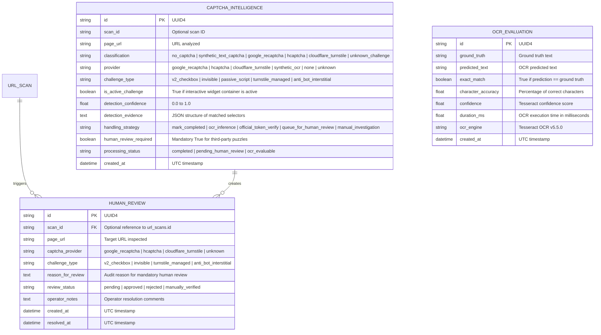

# Technology Brainz — CAPTCHA Inspector
## Phase 3: Architecture & System Design
### CAPTCHA Intelligence & Handling Engine

## 1. Executive Summary

Phase 3 introduces the **CAPTCHA Intelligence & Handling Engine** into the **CAPTCHA Inspector** ecosystem.

While Phase 1 established the backend foundations and Phase 2 introduced the smart website crawler, Phase 3 closes the automated loop by classifying every discovered CAPTCHA, selecting an ethical handling strategy, integrating local synthetic OCR analysis, validating official provider test tokens, and routing complex third-party puzzles into a persistent **Human Review Workflow**.

```mermaid
flowchart TD
    Discovered["Discovered Page / Crawl Result"] --> Classify["CAPTCHA Intelligence Engine\n(app/services/captcha_intelligence.py)"]
    
    Classify -->|Classification & Signals| Decision{"Handling Strategy Decision"}
    
    Decision -->|no_captcha| Complete["Strategy: mark_completed\n- Set status=completed\n- human_review_required=false"]
    Decision -->|synthetic_text_captcha| OCR["Strategy: ocr_inference\n- Run OpenCV + Tesseract\n- Persist OcrEvaluationRecord"]
    Decision -->|official_test_captcha| TokenVerify["Strategy: official_token_verify\n- Google Siteverify Official Test\n- Never expose secrets"]
    Decision -->|third_party_captcha\n(reCAPTCHA, hCaptcha, Turnstile)| QueueReview["Strategy: queue_for_human_review\n- human_review_required=true\n- Create HumanReviewRecord (pending)\n- Strictly NO automated bypass"]
    Decision -->|unknown_challenge\n(anti-bot interstitials)| Investigate["Strategy: manual_investigation\n- human_review_required=true\n- Create HumanReviewRecord (pending)"]
    
    QueueReview --> HumanReviewQueue[("Human Review Queue\n(Database: human_reviews)")]
    Investigate --> HumanReviewQueue
    
    HumanReviewQueue --> OperatorUI["Human Operator\n(PATCH /api/captcha/reviews/{id})"]
    OperatorUI -->|Operator Decision| AuditResolution["Statuses: approved | rejected | manually_verified\n(Includes operator notes + resolved_at timestamp)"]
```

---

## 2. Core Architecture Subsystems

### 2.1 CAPTCHA Intelligence Engine (`app/services/captcha_intelligence.py`)
A decoupled classification and decision engine that inspects DOM markup, document titles, or image payloads.

Key capabilities:
- **Provider Identification**: Recognizes Google reCAPTCHA, hCaptcha, Cloudflare Turnstile, anti-bot challenge interstitials, and synthetic distortion text.
- **Interactive Active vs. Passive vs. Invisible Distinction**:
  - `v2_checkbox` / `hcaptcha_checkbox` / `turnstile_managed`: Active DOM container present (`is_active_challenge = True`).
  - `invisible`: Token binding (`data-size="invisible"` or `grecaptcha.execute`).
  - `passive_script`: Vendor `<script>` tag included in document without an active widget container.
  - `anti_bot_interstitial`: Challenge screen ("Just a moment...", "cf-challenge-running", "datadome").
- **Signal Evidence Extraction**: Emits structured evidence breakdown with matched selectors, scripts, and heuristics.

### 2.2 Decision & Handling Workflow Matrix

| Discovered Type | Provider | Handling Strategy | Human Review Required | Automated Solving | Processing Status |
| :--- | :--- | :--- | :--- | :--- | :--- |
| **Clean Page** | `none` | `mark_completed` | False | N/A | `completed` |
| **Synthetic Text** | `synthetic_ocr` | `ocr_inference` | False | Yes (Owned OCR only) | `ocr_evaluable` |
| **Official Test Key**| `google_recaptcha` | `official_token_verify` | False | Yes (Official test server)| `official_test_ready`|
| **Google reCAPTCHA**| `google_recaptcha` | `queue_for_human_review`| **True** | **Strictly Forbidden** | `pending_human_review` |
| **hCaptcha** | `hcaptcha` | `queue_for_human_review`| **True** | **Strictly Forbidden** | `pending_human_review` |
| **Cloudflare Turnstile**| `cloudflare_turnstile`| `queue_for_human_review`| **True** | **Strictly Forbidden** | `pending_human_review` |
| **Unknown / Anti-Bot**| `unknown_anti_bot` | `manual_investigation` | **True** | **Strictly Forbidden** | `manual_investigation_required`|

---

## 3. Human Review Workflow Subsystem

The human review pipeline guarantees an auditable human-in-the-loop workflow:
1. **Automated Enqueueing**:
   - Discovered third-party CAPTCHAs during URL crawling or standalone inspections automatically persist a `HumanReviewRecord` with `review_status = "pending"`.
2. **Operator Queue Management**:
   - `GET /api/captcha/reviews`: Lists queue with status counters (`pending`, `approved`, `rejected`, `manually_verified`).
   - `GET /api/captcha/reviews/{id}`: Detailed inspection of the challenge and page context.
3. **Audited Operator Decisions**:
   - `PATCH /api/captcha/reviews/{id}`: Transitions review status to `approved`, `rejected`, or `manually_verified`.
   - Records the human operator's notes and the `resolved_at` UTC timestamp.
   - **Compliance Rule**: Manual verification is recorded strictly as an operator human decision, not as an automated CAPTCHA bypass.

---

## 4. Database Schema Extensions



---

## 5. Security & Ethical Automation Governance

1. **Non-Intrusive Detection**:
   - Crawlers and scanners detect containers and vendor scripts passively without triggering or solving challenges.
2. **Form Submission Barrier**:
   - The engine never populates form fields or submits contact forms on third-party domains.
3. **Third-Party Solving Prohibition**:
   - Modern behavioral, biometric, and computer-vision CAPTCHAs are never attacked with brute-force or bypass tools.
4. **Credential & Secret Protection**:
   - Official reCAPTCHA secret keys and client response tokens are never logged or exposed via API responses.
