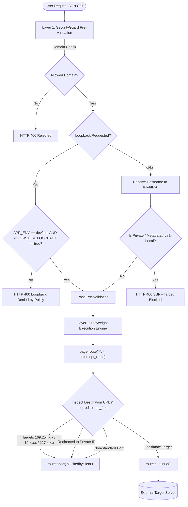
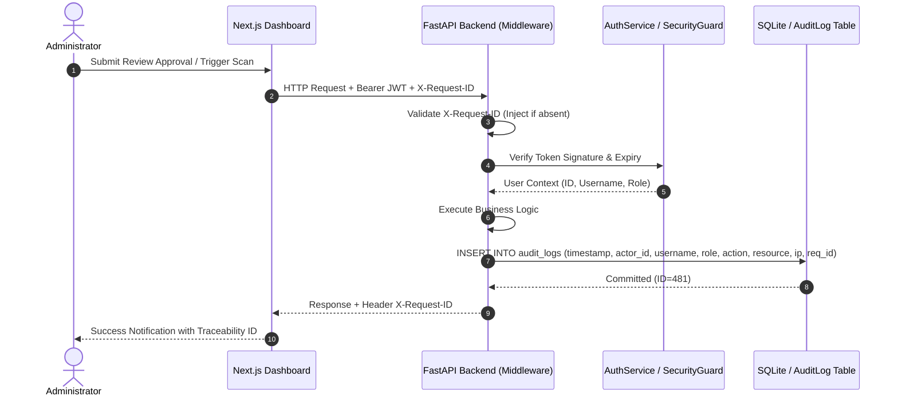

# Phase 5 Security Architecture & Threat Model

**Project:** Technology Brainz — CAPTCHA Inspector  
**Classification:** Internal Technical Architecture Document  
**Phase:** Phase 5 — Security Hardening & Production Readiness  
**Target Git Branch:** `phase-5-security-hardening`  
**Security Rating:** Hardened Enterprise SaaS  

---

## 1. Executive Summary & Security Philosophy

Phase 5 transitions the CAPTCHA Inspector from an advanced automated crawler prototype to a **defense-in-depth, zero-trust web application**. 

Prior to Phase 5, the system permitted client-controlled bypasses (e.g., `allow_loopback=true`), lacked cryptographic authentication, relied on unauthenticated API endpoints, and allowed unrestricted navigation inside Playwright without network-layer interception. 

The Phase 5 security architecture enforces four inviolable architectural principles:
1. **Zero Client Authority Over Security Boundaries:** Security policies (loopback access, port filtering, domain boundaries) are determined solely by server-side configuration and environment context (`APP_ENV`). No client request parameter can ever relax a security boundary.
2. **Pre-Dispatch Network Interception (Two-Layer SSRF Defense):** Web requests and headless browser navigations are filtered both before URL dispatch (DNS resolution and IP range classification) and at the raw Playwright network layer (`page.route("**/*")`) to block server-side request forgery (SSRF), DNS rebinding, internal subnets, and cloud metadata endpoints.
3. **Cryptographic Identity & Role-Based Access Control (RBAC):** All operational capabilities require digitally signed JWT tokens issued via bcrypt-hashed credential authentication. Endpoints are strictly partitioned into `Operator` and `Admin` privilege tiers.
4. **Immutable Cryptographic Auditability & Traceability:** Every sensitive operation, crawl dispatch, human review decision, administrative action, and rate-limit breach is tagged with an end-to-end `X-Request-ID` correlation token and committed to an append-only `AuditLog` table.

---

## 2. Threat Modeling & STRIDE Analysis

| Threat (STRIDE) | Attack Vector / Scenario | Pre-Phase 5 Vulnerability | Phase 5 Defense-in-Depth Mitigation | Residual Severity |
| :--- | :--- | :--- | :--- | :--- |
| **Spoofing Identity** | Attacker impersonates operator or admin to trigger scans or alter human review states. | Endpoints were unauthenticated; any network client could issue POST/PATCH requests. | Signed HS256 JWT tokens with expiration; passwords salted and hashed with `bcrypt` (work factor 12); constant-time comparison. | **Low** |
| **Tampering** | Attacker intercepts/modifies client requests to crawl unauthorized intranet services. | `allow_loopback=true` parameter accepted from query/body. | `allow_loopback` removed from client control. Server-side `ALLOW_DEV_LOOPBACK` strictly denied in staging/production. | **Mitigated** |
| **Repudiation** | Operator approves fraudulent review or scans forbidden domains without record. | No audit trail; logging was ephemeral console output. | Append-only `AuditLog` relational table storing timestamp, actor ID, username, role, IP address, action, and request correlation ID. | **Low** |
| **Information Disclosure (SSRF)** | Attacker directs Playwright crawler to `http://169.254.169.254/latest/meta-data/` or internal Kubernetes/Docker sockets. | Playwright navigated directly to input URLs; redirects could pivot to private IPs. | `SecurityGuard.validate_target_url` blocks RFC 1918/RFC 3927 IPs; Playwright `page.route` intercepts every subresource and redirect before socket dispatch. | **Mitigated** |
| **Denial of Service (DoS)** | Attacker floods `/api/websites/inspect-url`, `/ocr-benchmark`, or uploads a 1 GB CSV. | No rate limits; unlimited CSV row processing; unrestricted thread allocation. | In-memory token bucket rate limiter (5-30 req/min per IP); 5 MB upload ceiling; 300 maximum CSV rows. | **Low** |
| **Elevation of Privilege** | Standard operator attempts to create new users or alter system credentials. | No RBAC enforcement. | Role checks (`require_admin`) enforce HTTP 403 Forbidden for operator tokens attempting administrative actions. | **Mitigated** |

---

## 3. Two-Layer SSRF Defense Architecture

The CAPTCHA Inspector controls a headless Playwright Chromium instance. If uncontrolled, headless browsers represent an immense SSRF attack surface, capable of executing JavaScript, fetching stylesheets, and following HTTP 30x redirects into protected subnets.

Phase 5 establishes a **Two-Layer Pre-Dispatch Defense**:



### 3.1 Layer 1: SecurityGuard Host & DNS Pre-Validation
Before any browser instance is allocated, `SecurityGuard.validate_target_url()` inspects the target:
1. **Scheme Validation:** Enforces `http` or `https` exclusively.
2. **Loopback Server-Enforcement:** Rejects all loopback addresses (`127.0.0.1`, `localhost`, `::1`) unless `settings.can_allow_loopback` evaluates to True. That property strictly demands `APP_ENV in ("development", "test")` **AND** `ALLOW_DEV_LOOPBACK=True`. In `staging` or `production`, loopback is unconditionally denied.
3. **Port Filtering:** Restricts navigation to standard HTTP(S) ports (`80, 443, 8080, 8443, 8888`). Dynamic ports (`1024 < port <= 65535`) are only permitted when loopback development mode is explicitly active for mock test servers.
4. **DNS Resolution & IP Subnet Classification:** Resolves target hostnames against system DNS. Every returned IP address is checked against `ipaddress.is_private`, `ipaddress.is_loopback`, `ipaddress.is_link_local`, `ipaddress.is_reserved`, and cloud metadata IPs (`169.254.169.254`). If any resolved IP is non-public, the URL is rejected before opening the browser.

### 3.2 Layer 2: Playwright In-Browser Route Interception
To eliminate DNS rebinding, redirect pivoting, and secondary subresource attacks (e.g., ``), Playwright installs a route interception hook on every crawl page:
```python
async def intercept_route(route):
    req = route.request
    # Validate destination URL and any prior redirection hops
    for test_url in (req.url, req.redirected_from.url if req.redirected_from else None):
        if not test_url:
            continue
        parsed = urlparse(test_url)
        is_safe, reason = security_guard.is_safe_network_target(parsed.hostname, parsed.port)
        if not is_safe:
            logger.warning(f"Blocked SSRF route attempt: {test_url} ({reason})")
            await route.abort("blockedbyclient")
            return
    await route.continue_()
```
Even if an external web page attempts to redirect the browser to `http://169.254.169.254` or embedded local subnets, Playwright aborts the network request immediately with `blockedbyclient` before any TCP packet leaves the network interface.

---

## 4. Authentication, Authorization & RBAC Matrix

### 4.1 Token Specifications
- **Algorithm:** HMAC with SHA-256 (`HS256`).
- **Signature Secret:** Configured via `JWT_SECRET_KEY` in environment. Startup checks prevent using default development secrets in `staging` or `production`.
- **Payload Schema:**
  - `sub`: User UUID (`id`).
  - `username`: Unique username.
  - `role`: Role string (`admin` or `operator`).
  - `exp`: Expiration timestamp (default: 480 minutes / 8 hours).
  - `iat`: Issuance timestamp.

### 4.2 Role-Based Access Control Matrix

| System Resource / API Endpoint | Anonymous (Unauthenticated) | Role: Operator | Role: Admin |
| :--- | :---: | :---: | :---: |
| `GET /health`, `GET /api/health` | **Allowed (200)** | **Allowed (200)** | **Allowed (200)** |
| `POST /api/auth/login` | **Allowed (200)** | **Allowed (200)** | **Allowed (200)** |
| `GET /api/auth/me` | Rejected (401) | **Allowed (200)** | **Allowed (200)** |
| `POST /api/auth/logout` | Rejected (401) | **Allowed (200)** | **Allowed (200)** |
| `POST /api/websites/inspect-url` | Rejected (401) | **Allowed (200)** | **Allowed (200)** |
| `POST /api/websites/scan-batch` | Rejected (401) | **Allowed (200)** | **Allowed (200)** |
| `POST /api/websites/import` (CSV) | Rejected (401) | **Allowed (200)** | **Allowed (200)** |
| `GET /api/websites/scans/*` | Rejected (401) | **Allowed (200)** | **Allowed (200)** |
| `GET /api/captcha/reviews` | Rejected (401) | **Allowed (200)** | **Allowed (200)** |
| `PATCH /api/captcha/reviews/{id}` | Rejected (401) | **Allowed (200)** | **Allowed (200)** |
| `POST /api/captcha/ocr-demo` | Rejected (401) | **Allowed (200)** | **Allowed (200)** |
| `POST /api/captcha/ocr-benchmark` | Rejected (401) | **Allowed (200)** | **Allowed (200)** |
| `POST /api/captcha/verify-token` | Rejected (401) | **Allowed (200)** | **Allowed (200)** |
| `GET /api/auth/audit-logs` | Rejected (401) | Forbidden (403) | **Allowed (200)** |
| `POST /api/auth/users` (Provision User) | Rejected (401) | Forbidden (403) | **Allowed (200)** |
| CLI `backup-db`, `create-admin` | Local Shell Only | Local Shell Only | Local Shell Only |

---

## 5. Rate Limiting & Resource Quotas

To prevent distributed resource exhaustion, denial of service, and brute-force password guessing, Phase 5 integrates a sliding token-bucket rate limiter:

| Endpoint Scope | Bucket Capacity | Window | Enforced Action on Exhaustion |
| :--- | :--- | :--- | :--- |
| **Authentication (`/api/auth/login`)** | 5 requests | 60 seconds | HTTP 429 Too Many Requests, `Retry-After: 60` |
| **URL Crawl (`/api/websites/inspect-url`)** | 10 requests | 60 seconds | HTTP 429 Too Many Requests, `Retry-After: 60` |
| **Batch Pipeline (`/api/websites/scan-batch`)** | 10 requests | 60 seconds | HTTP 429 Too Many Requests, `Retry-After: 60` |
| **Human Review Updates (`/api/captcha/reviews`)** | 30 requests | 60 seconds | HTTP 429 Too Many Requests, `Retry-After: 60` |
| **Synthetic OCR Benchmarks (`/ocr-benchmark`)** | 5 requests | 60 seconds | HTTP 429 Too Many Requests, `Retry-After: 60` |

### Resource Ingestion Quotas
- **Maximum CSV File Size:** 5,242,880 bytes (5.0 MB). Files exceeding this threshold are rejected with HTTP 413 Payload Too Large.
- **Maximum CSV Ingestion Rows:** 300 valid rows per batch. Batches exceeding 300 rows are rejected with HTTP 400 Bad Request to prevent thread-pool saturation.

---

## 6. End-to-End Tracing & Immutable Audit Architecture



Every audit event record contains:
- `timestamp`: UTC datetime with microsecond precision.
- `actor_id`: UUID of the authenticated actor (or `None` for unauthenticated attempts).
- `actor_username`: Human-readable identifier.
- `actor_role`: Privilege level at the time of execution.
- `action`: Specific operation (e.g., `login_success`, `login_failed`, `inspect_url`, `review_updated`, `user_created`).
- `resource_type` & `resource_id`: Targeted entity.
- `ip_address`: Remote client IP address.
- `request_id`: Unique tracing UUID for log correlation.
- `details`: Structured JSON metadata.
