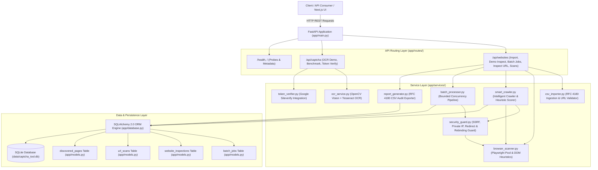
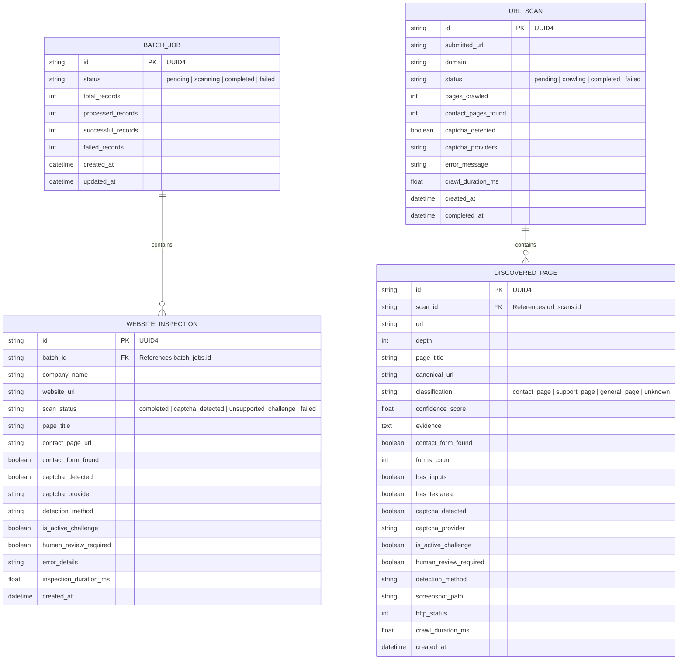

# Technology Brainz — CAPTCHA Inspector
## Project Architecture & Engineering Design

## 1. System Overview

**CAPTCHA Inspector** is an enterprise-grade backend system designed for website URL inspection, intelligent contact-page crawling, form analysis, CAPTCHA provider identification, SSRF-safe scanning, synthetic OCR benchmarking, and CSV compliance reporting.

The system is built with a layered, decoupled service architecture to support both standalone execution and integration with modern frontend SaaS interfaces (Next.js / TypeScript).

---

## 2. Technology Stack

### Backend
- **Language**: Python 3.12 (CPython)
- **Web Framework**: FastAPI v0.162.0 with Starlette and Pydantic v2
- **Browser Automation**: Playwright (Async Chromium Headless)
- **Computer Vision & Image Processing**: OpenCV (`cv2`) and Pillow
- **OCR Engine**: Tesseract OCR v5.5.0 via `pytesseract`
- **Data Persistence**: SQLAlchemy 2.0+ with SQLite (`data/captcha_tool.db`)
- **Testing & Quality Assurance**: Pytest 9.2.0, AnyIO, Starlette TestClient

### Frontend (Planned for Subsequent Phase)
- **Framework**: Next.js (App Router)
- **Language**: TypeScript
- **Styling**: Tailwind CSS
- **Component System**: Modern, responsive SaaS dashboard with live batch progress streaming, interactive CAPTCHA visualizer, and CSV report export.

---

## 3. Core Component Subsystems

### 3.1 Security Guard (`app/services/security_guard.py`)
Enforces strict defense-in-depth against Server-Side Request Forgery (SSRF) and unintended network intrusion:
- **Default Isolation**: `ENABLE_LIVE_SCAN=false` strictly blocks external HTTP calls unless explicitly configured.
- **Protocol Enforcing**: Only `http` and `https` allowed; `file://`, `ftp://`, `javascript:` rejected.
- **Private Subnet & Loopback Rejection**: RFC 1918 subnets (`10.0.0.0/8`, `172.16.0.0/12`, `192.168.0.0/16`), loopback (`127.0.0.0/8`, `::1`), link-local (`169.254.0.0/16`), and carrier-grade NAT (`100.64.0.0/10`) are rejected.
- **Cloud Metadata Defense**: Explicitly blocks cloud instance metadata endpoints (`169.254.169.254`, `fd00:ec2::254`).
- **Redirect Validation**: Re-validates HTTP redirect destinations during crawling to block cross-domain jumps or internal redirection tricks.
- **DNS Rebinding Protection**: Resolves all A/AAAA records before navigation; if any resolved IP belongs to a forbidden subnet, the request is aborted.

### 3.2 Smart Website Crawler Engine (`app/services/smart_crawler.py`)
- **URL Normalization**: Resolves relative paths, strips fragments (`#`), removes tracking parameters (`utm_*`, `fbclid`, `_ga`), lowercases hosts, and standardizes trailing slashes.
- **Intelligent Link Prioritization**: Uses breadth-first search (BFS) prioritizing links with contact/support path and anchor indicators.
- **Configurable Crawl Limits**: Max 10 pages per domain, max depth 2, 10s per-page navigation timeout, 60s total timeout.
- **Multi-Signal Heuristics**: Classifies discovered pages into `contact_page`, `support_page`, `general_page`, or `unknown` based on URL path, anchor text, title, content phrases, and form controls.
- **Evidence Capture**: Full page screenshots saved under `evidence/scans/<scan_id>/` and referenced in database records.
- **Robots.txt Support**: Respects robots.txt directives gracefully with non-blocking checks.

### 3.3 Detection Engine & Browser Pool (`app/services/browser_scanner.py`)
- **Browser Pooling**: Implements thread-safe, loop-aware Chromium browser pooling to eliminate full process restarts per page inspection.
- **Detection Heuristics**:
  - Distinguishes active widget containers (`.g-recaptcha`, `.h-captcha`, `.cf-turnstile`, challenge iframes) from passive vendor script tags.
  - Classifies anti-bot interstitial screens (Cloudflare "Just a Moment", Datadome, PerimeterX/HUMAN) as `unsupported_challenge`.
  - Marks `human_review_required = True` whenever third-party challenges are detected, guaranteeing zero automated bypass attempts.
  - Identifies contact forms by parsing `<form>` elements containing interactive input controls (`<input>`, `<textarea>`, `<button>`, `<select>`) or semantic contact keywords.

### 3.4 Batch Processing Pipeline (`app/services/batch_processor.py`)
- **Bounded Concurrency**: Bounded with `asyncio.Semaphore(settings.MAX_CONCURRENT_PAGES)` (default: 3) to prevent resource starvation or DoS against target servers.
- **Fault-Tolerant Continuation**: Per-site navigation timeouts and unexpected HTTP failures are caught and logged without aborting remaining batch items.
- **Database Persistence**: State transitions and metrics are persisted in SQLite.

### 3.5 Synthetic OCR & Benchmark Service (`app/services/ocr_service.py`)
- **Synthetic CAPTCHA Generator**: Synthesizes variable-length alphanumeric images with geometric lines, character rotations, and salt-and-pepper noise dots using Pillow.
- **Computer Vision Filtering**: Applies OpenCV bilateral filter for edge-preserving denoising, Otsu adaptive thresholding, and morphological opening.
- **Inference Configuration**: Configured with `--oem 3 --psm 7` (Single text line) to ensure authentic character confidence extraction and avoid the Tesseract 5 LSTM zero-confidence anomaly.
- **Limitation Reporting**: Evaluates accuracy against known ground truth while explicitly documenting that modern behavioral CAPTCHAs cannot be solved by traditional OCR.

### 3.6 Token Verification Client (`app/services/token_verifier.py`)
- Integrates Google's official public reCAPTCHA test keys:
  - Site Key: `6LeIxAcTAAAAAJcZVRqyHh71UMIEGNQ_MXjiZKhI`
  - Secret Key: `6LeIxAcTAAAAAGG-vFI1TnRWxMZNFuojJ4WifJWe`
- Performs server-side validation against `https://www.google.com/recaptcha/api/siteverify`.
- Handles full verification matrix: Valid test response, Missing token, Invalid token, and Expired/Reused token.

---

## 4. Database Schema Design

---

## 5. Windows Concurrency & Subprocess Considerations
- Configured with `WindowsProactorEventLoopPolicy` in `app/main.py`.
- Uvicorn should be run directly without `--reload` on Windows to avoid parent/child process pipe destruction when Playwright child processes are active.
