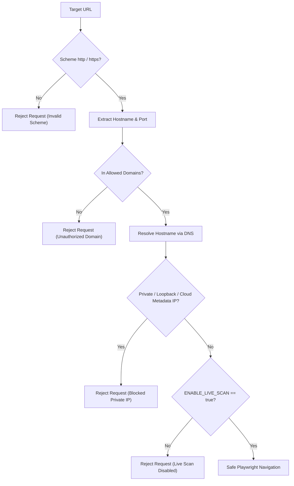

# Security Policy, Safety Controls & Responsible Scanning

## 1. Ethical & Safety Mandates

This application is strictly designed as an **authorized inspection, detection, and classification tool**. It adheres to strict responsible automation principles:

- **No CAPTCHA Bypass or Solver Attacking**: The system NEVER attempts to crack, bypass, or defeat third-party CAPTCHA systems (reCAPTCHA, hCaptcha, Turnstile, Cloudflare).
- **No Form Submission**: The scanner operates in strict read-only mode. It does NOT submit contact forms, send emails, or dispatch messages.
- **No Token Harvesting**: The tool does not intercept, harvest, or reuse validation tokens from target websites.
- **No Authentication / Payment Interference**: The crawler only identifies public contact pages and forms; it never accesses login, administrative, or payment endpoints.
- **Controlled Concurrency**: Concurrency is strictly bounded (default: 3 concurrent pages) to prevent accidental denial of service (DoS) or rate-limit violations.

---

## 2. Server-Side Request Forgery (SSRF) Protection

Uncontrolled browser navigation poses severe SSRF risks in bulk URL scanning. The `SecurityGuard` enforces the following defenses before Playwright navigates:

### 2.1 Blocked IP Ranges
- **Loopback**: `127.0.0.0/8`, `::1`
- **Private Subnets (RFC 1918)**:
  - `10.0.0.0/8`
  - `172.16.0.0/12`
  - `192.168.0.0/16`
- **Link-Local & Cloud Metadata**:
  - `169.254.0.0/16` (including AWS/GCP metadata service `169.254.169.254`)
- **Carrier-Grade NAT**: `100.64.0.0/10`
- **Broadcast / Multicast**: `224.0.0.0/4`, `255.255.255.255`

### 2.2 DNS Rebinding Defense
The hostname is resolved to all associated IPv4/IPv6 addresses immediately before opening the browser tab. If any returned IP falls into a restricted range, the navigation is aborted immediately.

---

## 3. Human Review Classification

When an anti-bot challenge interstitial, WAF gate, or complex defense is encountered, the tool marks the website as:
- `scan_status`: `human_review_required` or `unsupported_challenge`
- `human_review_required`: `true`

This alerts operators to inspect the page manually without violating anti-bot terms of service.

---

## 4. Secret & Credential Sanitization
- API keys, reCAPTCHA secret keys, and internal database paths are loaded strictly via `.env` or environment variables.
- Logs and API responses sanitize any sensitive tokens, query parameters, or authorization headers.
